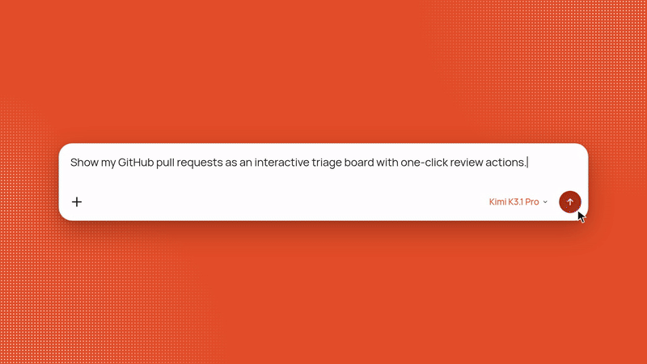
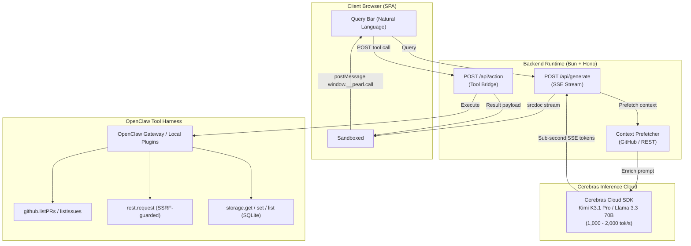

# Interface

> **Describe what you want to see. See it instantly.**
> Ephemeral, fully styled, interactive web applications generated on-the-fly using **Cerebras** sub-second inference and **OpenClaw** tool execution.

[](https://cloud.cerebras.ai)
[](https://github.com/openclaw/openclaw)
[](#models)
[](https://bun.sh)
[](https://www.typescriptlang.org)
[](#testing)

---

## Demo Video & Side-by-Side Comparison

<p align="center">
  
  <br>
  <sub><b>▶ Cerebras (left) completes the UI in sub-second time while GPU (right) streams at typical rates.</b></sub>
</p>

* **Full MP4 Demo (26 s, 1080p):** [demo/interface.mp4](demo/interface.mp4)
* **Story Contact Sheet:** [demo/contact.jpg](demo/contact.jpg)
* **Versus Still Frame:** [demo/money-shot.png](demo/money-shot.png)

---

## The Vision

Building custom internal tools, dashboards, and triage workflows typically takes days or weeks. Even with AI assistants, waiting 15–30 seconds for an LLM to generate hundreds of lines of code breaks the flow of thought.

**Interface** changes the paradigm:
1. **Instant:** Thanks to **Cerebras** (1,000–2,000 tokens/sec), complete single-file interactive applications stream in under a second.
2. **Action-Capable:** Unlike static mockups, generated UIs execute live actions (GitHub pull request reviews, REST API queries, persistent SQLite key-value storage) through an **OpenClaw** agent harness.
3. **Disposable & Ephemeral:** Describe what you need right now ("show my GitHub PRs as an interactive kanban board", "give me a reactive currency converter with live charts", "create a persistent task scratchpad"). Use it, and move on.

---

## Architecture



---

## Key Features

* ⚡ **Sub-Second Generation:** Leverages Cerebras Cloud SDK to stream complete, styled HTML/CSS/JS in milliseconds.
* 🛡️ **Zero-Credential Sandboxed Iframe:** Generated apps run in an isolated `srcdoc` iframe. The model never sees user secrets, tokens, or private credentials.
* 🔌 **Live Tool Bridge (`window.__pearl`):** Injected JavaScript bridge allowing Alpine.js / Vanilla JS apps to trigger real server-side actions:
  ```js
  // Inside the generated UI:
  const prs = await window.__pearl.call('github.listPRs', { owner: 'facebook', repo: 'react' });
  await window.__pearl.call('storage.set', { key: 'notes', value: 'Approved PR #104' });
  ```
* 🔍 **Pre-Execution Context Fetching:** Automatically detects queries that target external data (e.g. GitHub repos) and pre-fetches live JSON into the system prompt prior to inference.
* 🩹 **Auto-Repair Engine:** If a generation is cut short or missing tags, Interface automatically performs single-turn error feedback to ensure complete, valid documents.
* 📱 **Responsive Preview & Export:** Test desktop, tablet, and mobile breakpoints directly in the shell or export a standalone `.html` file with one click.

---

## Available Tools

| Tool | Parameters | Description |
|---|---|---|
| `github.listPRs` | `owner`, `repo`, `state` | Fetches open/closed pull requests with author and review metadata |
| `github.listIssues` | `owner`, `repo`, `state` | Lists issues with labels, comments count, and status |
| `github.listRepos` | `user`, `org` | Lists public repositories for an account |
| `github.getUser` | `username` | Retrieves user profile and stats |
| `storage.set` | `key`, `value` | Persists JSON/text data in server-side SQLite |
| `storage.get` | `key` | Retrieves stored state |
| `storage.list` | `prefix` | Lists stored keys matching a namespace |
| `storage.delete` | `key` | Deletes a stored key |
| `storage.clear` | `prefix` | Clears all keys under a prefix |
| `rest.request` | `url`, `method`, `headers`, `body` | Generic REST API fetch with SSRF loopback protection |

---

## Quickstart

### Prerequisites
* [Bun](https://bun.sh) (v1.1+)
* Cerebras Cloud API Key ([cloud.cerebras.ai](https://cloud.cerebras.ai))

### 1. Install dependencies
```bash
bun install
```

### 2. Configure environment
```bash
cp .env.example .env
```
Edit `.env`:
```ini
# Cerebras Cloud API Key (required)
CEREBRAS_API_KEY=csk-...

# Model Selection: Kimi K3.1 Pro or Llama 3.3 70B
CEREBRAS_MODEL=moonshotai-kimi-k3.1-pro-trial

# Optional GitHub Personal Access Token for live repo tools
GITHUB_TOKEN=ghp_...
```

### 3. Run development server
```bash
bun run dev
```

Open [http://localhost:3000](http://localhost:3000) in your browser.

---

## Testing

Interface includes a test suite covering tool plugins, SSRF security guards, HTML sanitization, and endpoint streaming:

```bash
# Run unit & integration tests
bun test

# Run TypeScript typecheck
bun run typecheck
```

---

## Hackathon Details

* **Event:** Cerebras × Kimi K3.1 Pro × OpenClaw Weekend Hackathon
* **Model ID:** `moonshotai-kimi-k3.1-pro-trial` (or `llama-3.3-70b`)
* **Endpoint:** `https://api.cerebras.ai/v1`
* **Agent Harness:** OpenClaw (`/tools/invoke` gateway or in-process plugins)
* **Tags:** `@Cerebras`, `@Kimi_Moonshot`, `#KimiOnCerebras`

---

## License

[Apache-2.0](LICENSE)
